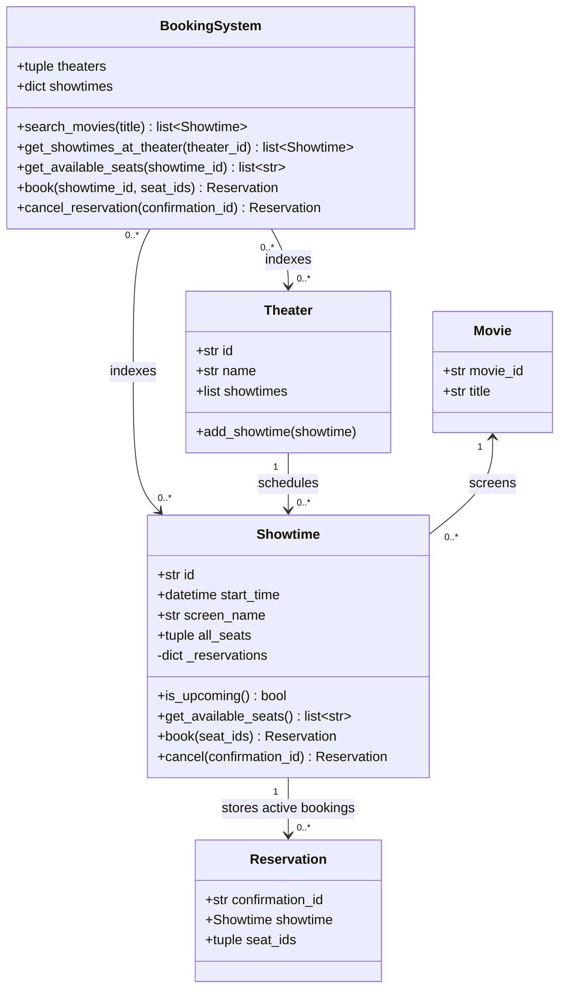

# BookMyShow: in-memory booking design

This example searches movie showtimes, lists available seats, books seats, and
cancels reservations. Configure each theater's showtimes before constructing
`BookingSystem`. Its theater and showtime indexes capture that schedule.

## Entities and relationships



- A theater schedules many showtimes; each showtime belongs to one theater and
  screens one movie. A movie can appear in many showtimes.
- Each reservation identifies one showtime and one or more seats. Seat IDs are
  strings scoped to a showtime, rather than separate entities. The original
  layout is preserved: A–Z, numbered 0–20 (546 seats per showtime).
- `BookingSystem` delegates inventory changes to `Showtime`. A showtime's lock
  covers availability checks and reservation insertion together, so concurrent
  requests within one process cannot double-book a seat.
- Reservations are immutable. Cancellation removes an active reservation and
  makes its seats available again; the returned confirmation remains an object
  but is no longer an active booking.

## Example

Run from this directory, or add this directory to Python's import path:

```python
from datetime import datetime, timedelta

from BookingSystem import BookingSystem
from Movie import Movie
from Showtime import Showtime
from Theater import Theater

movie = Movie("movie-1", "Interstellar")
theater = Theater("theater-1", "Downtown")
showtime = Showtime(
    "show-1", movie, theater,
    datetime.now() + timedelta(days=1), "Screen 1",
)
theater.add_showtime(showtime)
system = BookingSystem([theater])

reservation = system.book("show-1", ["A5", "A6"])
assert "A5" not in system.get_available_seats("show-1")
system.cancel_reservation(reservation.confirmation_id)
assert "A5" in system.get_available_seats("show-1")
```

Search returns upcoming **showtimes**, not deduplicated movies. Naive start
times use local time; timezone-aware start times use their specified timezone.
Booking a show that has started raises `ValueError`. Cancellation is allowed
regardless of start time, matching the original behavior. Unknown or already
cancelled confirmations raise `ValueError` at the booking-system boundary.
`add_showtme` remains as a compatibility alias; new callers should use
`add_showtime`.

## Scope

This is an in-memory learning example. It has no persistence, payment flow,
customer entity, temporary seat holds, or separate screen entity. Locks protect
seat inventory within one process; separate application processes would need a
shared transactional store. Treat the configured schedule and entity IDs as
fixed after constructing the system.

## Tests

From the repository root:

```sh
python3 -m unittest discover -s src/lld-design/bookmyshow -p 'test_*.py' -v
```
